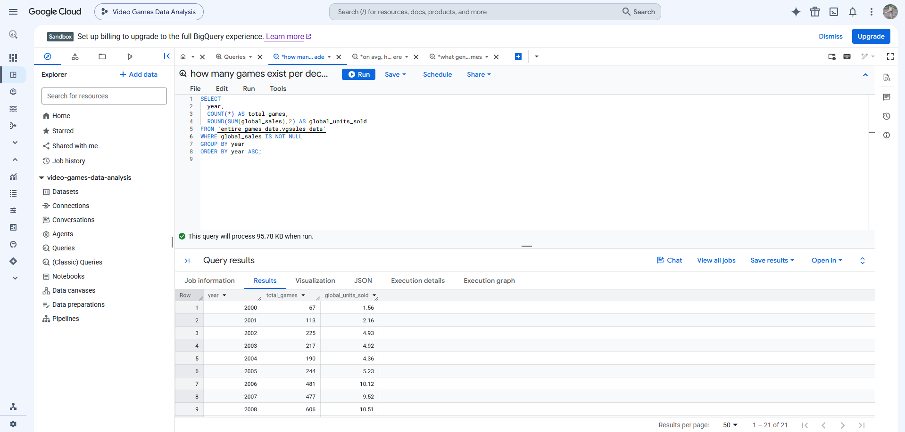
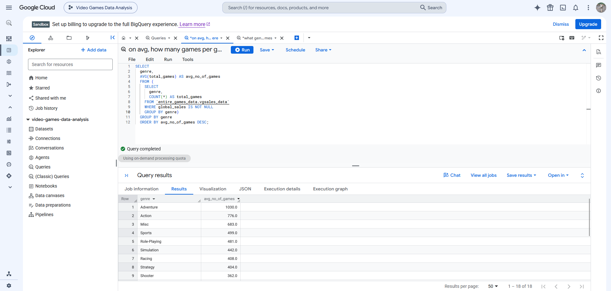
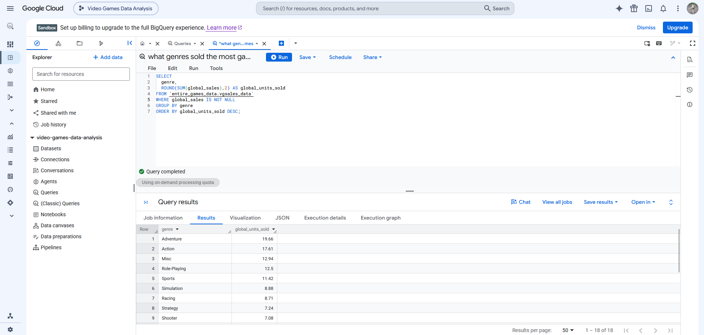
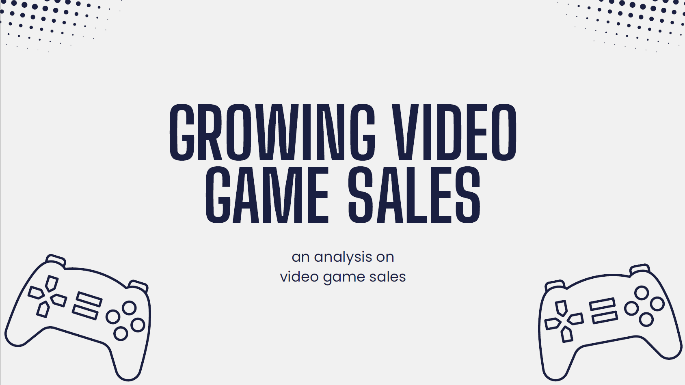

# Vanessa Littler | Growing Video Game Sales Project

An analysis on the video games industry.

## Quick links

- [Analytics dashboard](https://public.tableau.com/app/profile/vanessa.littler/viz/videogamesanalysis_17915487186250/VideoGameAnalysis#1)
- [About the project](#about-the-project)
- [Tools used](#tools-used)
- [Data](#data)
- [Project artifacts](#project-artifacts)
- [Project deliverables](#project-deliverables)

## About the project

This is a personal project which explores video game industry data to help better understand sales performance and market trends. I did this with the intention to then present research, data findings and actionable insights to a group of stakeholders from a fictional game developer company to help solidify business goals and improve sales performance.

Key questions to answer:
- Which year performed the best based on unit sales?
- What was the split between the varying game genres available?
- Overall, which game genre performed the best based on unit sales?

For this project, the video games industry was chosen as the focus as this is an area that has always fascinated me. I enjoy playing video games myself and I've always found it interesting to see the variety of games available over the years, as well as understanding how each perform and what can influence best-selling games across the market.

## Tools used

- Python
- SQL
- BigQuery
- Tableau
- Excel
- PowerPoint

## Data

The data used within this project was sourced by a data scraper ([vgchartzScraper](https://github.com/GregorUT/vgchartzScrape)) originally found linked to the Video Game Sales dataset available on [Kaggle](https://www.kaggle.com/datasets/gregorut/videogamesales).

Fields within this data set are:
- Rank - ranking of overall sales
- Name - the name of the game
- Platform - the platform the game released on (e.g. PC, Xbox, Playstation, Nintendo)
- Year - year of the game's release
- Genre - genre type of the game
- Publisher - the name of the game's publisher
- NA_Sales - unit of sales within North America (in millions)
- EU_Sales - unit of sales within Europe (in millions)
- JP_Sales - unit of sales within Japan (in millions)
- Other_Sales - unit of sales outside of previous regions (in millions)
- Global_Sales - unit of sales worldwide (in millions)

The original dataset available on Kaggle was limited to older records (prior to 2020) which is why I decided to run the data scraper myself. Doing this helped highlight a major challenge with the data, which was incomplete or redundant information.

The issue I'd found was that whilst the data scraper was capable of updating the dataset, the original website source that the data scraper is reliant on wasn't complete or up to date itself. This meant that after pulling the data, the majority of the games information which were listed with a release between 2021-2026 were incomplete and at times, creating incorrect information. 

To counter this, I cleaned the dataset using SQL and BigQuery to remove any NULL values as well as the incomplete and redundant information. This meant that with my data, I could only base my research and evaluations on games released prior to 2020.

## Project artifacts

### How many games exist per decade?

The above data query was created to help answer _'Which year performed the best based on unit sales?'_. For this, the table was done to pull each year group, a count of total games within each year group alongside the total global units sold per year group. I ensured NULL values were not included and ordered the results by year ascending.

From this, I found that the best performing year was 2009 with a total of **12.34 million** global units sold. It also helped to highlight immediate issues with the data despite removing NULL values, showing more recent years (2019 and 2020) with less than **1 million** global units sold.

### On average, how many games are available per genre?

This data query was done to help answer _'What was the split between the varying game genres available?'_. From the data, the table created pulls each genre group (i.e. Shooter, Racing, Puzzle) and calculates the average number of games within each genre based on total games overall.

Here, we can see that the **Adventure** genre has the highest average number of games with a total average of **1030** whereas the lowest was **Board Games** with only an average of **2**.

### What genre sold the most games?

The last data query above was done to answer _'Overall, which game genre performed the best based on unit sales?'_. The written query creates a table which showcases each genre group alongside the total sum of global units sold. This sum is then rounded to 2 decimal places.

With this table, the highest amount of global units sold was **19.66 million**, showing that **Adventure** games is the best selling genre across the entire time period. The 2nd best-selling genre is **Action** games, which has a **2.05** difference between the top genre group.

## Project deliverables

### Growing Video Game Sales Presentation

The presentation focuses on the narrative that video game developers need to focus on upcoming technology, new console releases and game development for adventure games. The full [Growing Video Games Sales Presentation](https://github.com/vlittler/video-game-analysis/raw/refs/heads/main/Growing%20Video%20Game%20Sales.pptx) has also been uploaded for download.

For this, I utilised Tableau to create a [dashboard](https://public.tableau.com/app/profile/vanessa.littler/viz/videogamesanalysis_17915487186250/VideoGameAnalysis#1) and used this to answer the original questions outlined for the project.

Showcased are video game sales across the years as well as potential influences to the market such as console releases to help explain where global sales have peaked or dropped. Issues with the data has also been covered with a view on the data lag and discussing potential impacts to the industry due to the COVID-19 pandemic.

Included in the presentation is also a breakdown on top performing genres and a comparison of their average global sales, highlighting Adventure games as the best focus for new game development due to overall performance and popularity.
